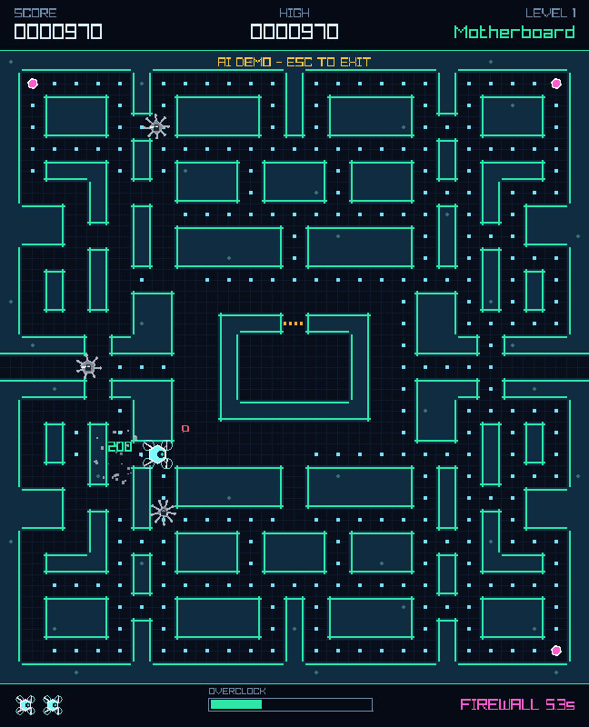
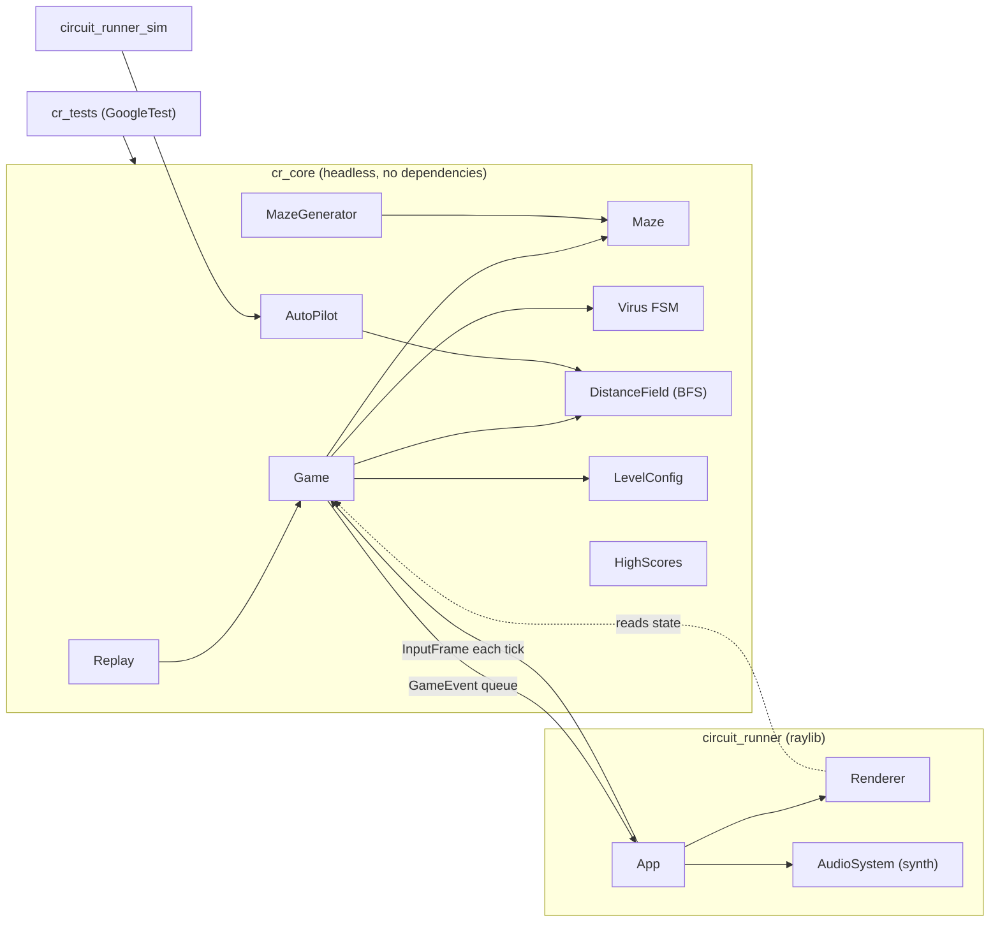

# Circuit Runner

**An arcade maze-chase game written in modern C++20 with raylib.** You pilot a repair drone through a circuit board, collecting data packets while four viruses hunt you. Each virus has its own AI strategy.



[](https://github.com/kavya-patel-1310/circuit-runner/actions/workflows/ci.yml)


---

## Highlights

| Area | What's implemented |
|---|---|
| **Game AI** | 4 enemy agents driven by a finite-state machine (`InBase → Leaving → Active ⇄ Frozen → Quarantined`) and BFS distance fields, each with its own targeting strategy: pursuit, input prediction, two-agent pincer, and teleporting roamer |
| **Procedural generation** | Endless levels after the hand-made ones: randomised DFS → dead-end braiding → mirroring → BFS connectivity repair. Tested on 300 seeds |
| **Deterministic simulation** | Integer fixed-point movement, custom PRNG and a fixed 60 Hz timestep, so the same seed and inputs always give a bit-identical game |
| **Replays** | Every game is recorded to a small run-length-encoded `.crr` file (about 5 KB for a full game) and can be played back exactly |
| **Self-playing bot** | Uses a danger-field + goal-field BFS planner. It powers the title-screen attract mode, the headless simulator and the soak tests |
| **Architecture** | The headless `cr_core` library has zero graphics dependencies. The front-end only reads game state and receives game events |
| **Testing** | 61 GoogleTest cases cover movement, pathfinding, AI, scoring, generation, replays and persistence, plus long bot-played soak tests |
| **Tooling** | CMake + FetchContent, GitHub Actions CI on Linux/Windows/macOS, `-Werror` and ASan/UBSan builds |

**Also in the game:** power-up freeze with a 200/400/800/1600 combo, an overclock speed-boost meter, timed bonus keys, extra lives, wrap-around tunnels, a difficulty curve, a top-10 high-score table with name entry, pause menu, gamepad support, resizable letterboxed window and fullscreen, particles, screen shake, a debug overlay that shows AI targets (F1), and sound effects synthesised at runtime, so there are no audio files.

---

## Build & run

Requirements: a C++20 compiler (GCC 11+, Clang 14+, MSVC 2022), CMake ≥ 3.20 and Git. CMake downloads raylib and GoogleTest automatically.

```bash
git clone https://github.com/YOUR_USERNAME/circuit-runner.git
cd circuit-runner
cmake -S . -B build -DCMAKE_BUILD_TYPE=Release
cmake --build build -j
./build/circuit_runner            # Windows: build\Release\circuit_runner.exe
```

**Linux only:** install the X11/GL/ALSA headers first:
```bash
sudo apt install libx11-dev libxrandr-dev libxinerama-dev libxcursor-dev libxi-dev libgl1-mesa-dev libasound2-dev
```

Run the tests:
```bash
ctest --test-dir build --output-on-failure
```

### Command-line options

```
circuit_runner --demo                 # watch the AI play
circuit_runner --replay last_replay.crr
circuit_runner --seed 42              # reproducible procedural levels
circuit_runner --fullscreen

circuit_runner_sim --games 20 --seed 1              # headless AI benchmark
circuit_runner_sim --verify-replay last_replay.crr  # re-simulate a replay and print its hash
```

## Controls

| Action | Keyboard | Gamepad |
|---|---|---|
| Move | Arrows / WASD | D-pad / left stick |
| Overclock (when the meter is full) | Space | A / Cross |
| Pause | P / Esc | Start |
| Mute · AI overlay · Fullscreen | M · F1 · F11 | — |

---

## Architecture



* **The simulation is input → state.** Each tick `Game::tick(InputFrame)` advances one fixed step. The game never calls audio or graphics. It pushes `GameEvent`s (packet eaten, virus quarantined…) and the front-end turns them into sound and particles. That split is what makes the core testable, replayable and usable without a window.
* **Fixed-point movement.** Positions are integers in 1/1200-tile units, and turns happen only at exact tile centres. This avoids floating-point drift, so replays match on every platform.
* **Data-driven levels.** Mazes are plain text files in `assets/levels/`. Speeds, timers and the mode schedule are set per level in `LevelConfig`, so tuning difficulty never touches game logic.

### Enemy AI

Every virus steers by **true shortest-path distance** (a BFS distance field from its target). A straight-line heuristic can get an agent stuck behind walls; shortest-path steering can't. U-turns are forbidden except when the mode changes, which keeps movement readable for the player. A global schedule alternates **Patrol** (each virus heads to its home corner) and **Hunt**:

| Virus | Hunt strategy |
|---|---|
| **Worm** | Direct pursuit of the player's tile |
| **Trojan** | Simulates the player 5 tiles ahead along corridors, reading the buffered input |
| **Rootkit** | Pincer: picks the tile 2–6 steps from the player that is farthest from the Worm, so the two close in from opposite sides |
| **Glitch** | Switches between chasing and roaming, and teleports to a tile 9–15 steps away after a 1-second visible warning |

### Procedural levels

1. Randomised depth-first search carves a perfect maze over the left half on a cell grid.
2. **Braiding** opens a wall at every dead end, and ~8% extra walls are removed. Dead ends are unfair in a chase game.
3. The half is mirrored, then the virus base, gate, tunnel and power-ups are added.
4. A **BFS repair pass** keeps knocking through mirrored wall pairs until every tile is reachable.

The result goes through the same parser and validator as the hand-made levels.

---

## Project layout

```
src/core/      headless game library (simulation, AI, generation, replays)
src/app/       raylib front-end: screens, renderer, synthesised audio
tools/         circuit_runner_sim - headless benchmark / replay verifier
tests/         GoogleTest suite
assets/levels/ hand-designed mazes (plain text)
```

### Making your own level

Add a `.txt` file to `assets/levels/`. Files load in filename order:

```
#  wall        .  packet       o  firewall core    -  base gate
B  base floor  1 2 3  virus slots                   P  player spawn
E  base exit   S  bonus-key spawn                   space / _  empty floor
```
An open tile on the border becomes a wrap-around tunnel. Invalid files are reported with a row and column, and are rejected if any packet can't be reached.

## Performance

The headless simulator runs a full game with the AI bot at roughly **550× real time** on one core (`circuit_runner_sim`), including four BFS-steered enemies and the bot's two multi-source BFS passes per tick.

## Possible extensions

* Train the bot with reinforcement learning, using the headless simulator as the environment
* An online leaderboard that validates scores by re-simulating replays on the server
* A WebAssembly build via Emscripten (raylib supports it)

## License

MIT. See [LICENSE](LICENSE). All art is drawn in code and all sound is synthesised, so the game contains no third-party assets.
